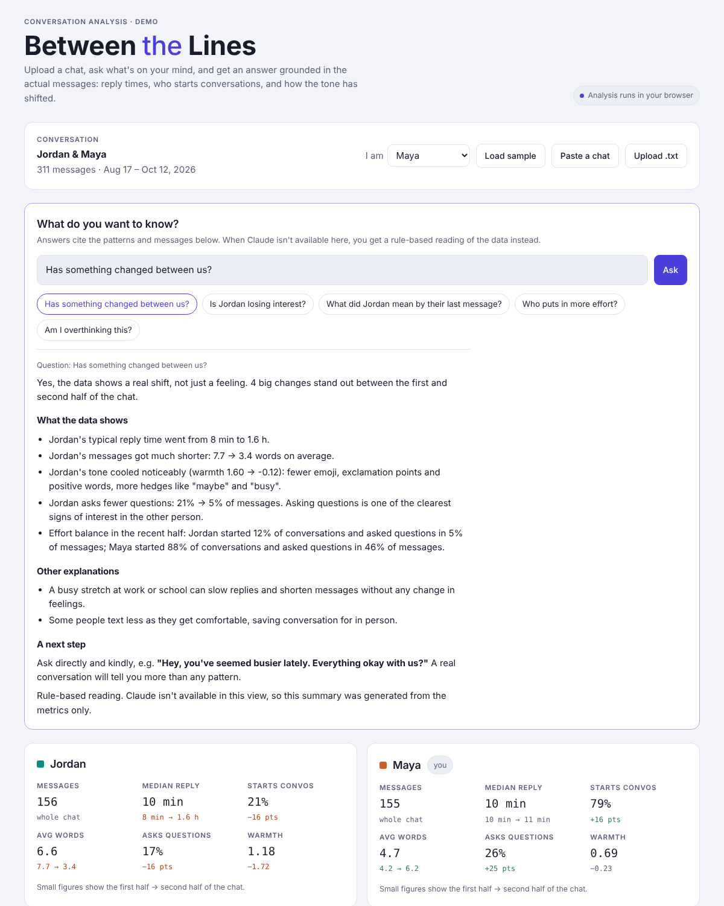

# Between The Lines

> "Wait, what did they mean by that?"
> "Am I overthinking this, or has something actually changed?"

**Between The Lines** lets you upload a text conversation, ask the question on your mind, and get an answer based on the actual messages and communication patterns instead of guesswork. It combines data science, NLP and AI to surface patterns that aren't obvious when you're inside the conversation: response times, who starts conversations, how the tone has shifted, and more.



## Status

This is a **working demo / prototype**. It runs entirely in the browser with no build step and no backend. The sample conversation (Maya & Jordan) is fictional and generated from a fixed seed.

## Quick start

```bash
git clone https://github.com/<your-username>/between-the-lines.git
cd between-the-lines
python3 -m http.server 8000      # or just open index.html in a browser
```

Then open <http://localhost:8000>.

To host it for free, turn on **GitHub Pages** (Settings → Pages → Deploy from branch → `main` / root).

## Features

| Feature | What it does |
|---|---|
| **Import** | Paste a chat, upload a `.txt` export, or load the sample. |
| **Ask a question** | Free text or suggested prompts ("Has something changed?", "What did they mean by their last message?"). Answers follow a fixed format: direct answer, evidence, other explanations, next step. |
| **Per-person metrics** | Message count, median reply time, share of conversations started, average words, question rate, warmth score. Each one compares the first half of the chat with the second. |
| **What changed** | Automatically flags shifts as *Big shift* / *Notable* / *Stable*. |
| **Week-by-week charts** | Message volume, median reply time, and warmth per week. |
| **Annotated transcript** | Recent messages with slow replies (>1 h) highlighted. |

### Supported chat formats

```
[2026-09-03 19:42] Maya: did you see this?
9/3/26, 7:42 PM - Maya: did you see this?          (WhatsApp, Android)
[9/3/26, 7:42:10 PM] Maya: did you see this?       (WhatsApp, iOS)
```

Multi-line messages are joined. In group chats only the two most active people are analyzed (for now).

## How the analysis works

All logic lives in [`js/app.js`](js/app.js).

| Metric | Definition |
|---|---|
| **Conversation start** | The first message after a gap of **8+ hours**. |
| **Reply time** | Time between a message and the next message from the *other* person, if under 8 h. Reported as a median, so a few outliers don't skew it. |
| **Warmth** | A lexicon score per message: positive words, emoji and exclamation points add; negative words and hedges ("maybe", "not sure", "we'll see", "busy", "later") subtract; slightly longer messages get a small bonus. |
| **Question rate** | Share of messages containing `?`. |
| **Early vs. recent** | The chat is split in half by time, and each metric is compared across the two halves. |

**Answering questions.** When the page runs inside a Claude artifact, it sends the metrics, findings and recent messages to Claude with a structured prompt (`buildPrompt` in `app.js`). Everywhere else, including GitHub Pages and local runs, it falls back to a **rule-based answer** generated from the findings (`fallbackAnswer`).

## Project structure

```
between-the-lines/
├── index.html            # Page layout
├── css/styles.css        # Theme tokens (light + dark) and layout
├── js/app.js             # Parsing, metrics, findings, charts, Q&A
├── sample/maya-jordan.txt  # Fictional sample conversation
└── docs/screenshot.png
```

## Roadmap / ideas to explore

- [ ] **Real sentiment model**: swap the word lexicon for a transformer model (e.g. a Hugging Face sentiment or emotion classifier), possibly in-browser with transformers.js.
- [ ] **AI backend**: a small server (Python/FastAPI or Node) that calls an LLM API, so Q&A works outside Claude. API keys must stay on the server, never in front-end code.
- [ ] More import formats: iMessage, Instagram, Discord, Telegram JSON.
- [ ] Change-point detection to find *when* a shift happened instead of a fixed half split.
- [ ] Topic modeling: what you talk about and how that changes.
- [ ] Sarcasm, humor and inside-joke handling.
- [ ] Full group-chat support.
- [ ] Evaluation: a labeled dataset to check whether the findings match human judgment.

## Privacy & ethics

- Parsing and metrics run **locally in the browser**. Nothing is uploaded unless you use the AI question feature.
- Conversations involve another person who didn't consent to analysis. Treat their messages with care, and don't commit real chats to this repo.
- Texting patterns are **signals, not proof** of how someone feels. People get busy, change habits, and text differently than they talk. The app should encourage a real conversation, not replace one.

## Contributing

1. Create a branch: `git checkout -b feature/your-idea`
2. Make your changes and test with `sample/maya-jordan.txt` plus a chat format of your own.
3. Open a pull request describing what changed and why.

Please use only fictional or fully anonymized conversations in issues, PRs and test files.

## License

[MIT](LICENSE)
